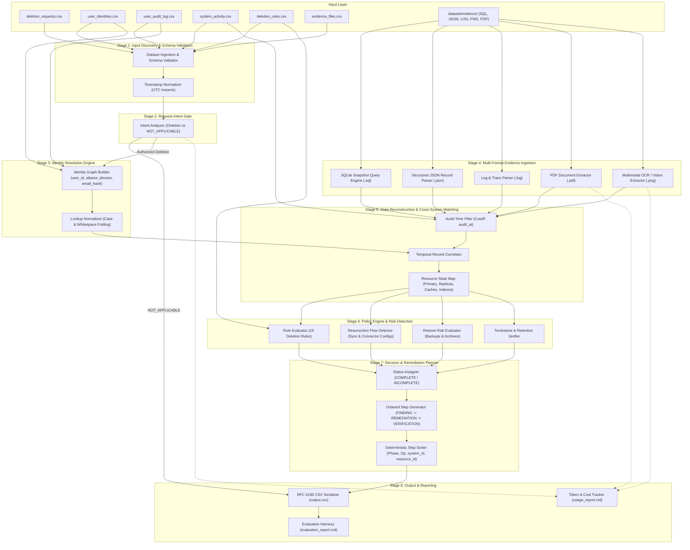

# System Architecture

## 1. Architectural Philosophy and Design Principles

The **Ghost Data Still Exists** deletion-audit agent is designed around a **deterministic, evidence-driven core**. 

In high-stakes compliance and data forensics, autonomous agents cannot rely on unconstrained probabilistic generation to determine whether personal data exists or whether a legal deletion mandate has been fulfilled. An LLM or multimodal AI model may be employed where heuristic or semantic interpretation is genuinely required—such as classifying natural-language intent across multilingual deletion requests or interpreting unstructured log messages and UI screenshots—but **the system must never permit an AI model to hallucinate records, invent identifiers, create policies, or fabricate proofs of deletion**.

### Key Architectural Tenets:
1. **Evidence Before Conclusion:** Claims from workflows, logs, or dashboards (`reported_status`) are treated as unverified claims until corroborated by tangible evidence.
2. **Policy-Driven Treatment:** Policies from `deletion_rules.csv` govern data treatment dynamically; no case-specific hardcoded shortcuts.
3. **Deterministic Core:** Identity joins, temporal filtering, policy evaluation, step sorting, and CSV serialization are executed by ordinary, deterministic code.
4. **Strict Audit-Time Boundaries:** Evidence captured after `audit_at` must never leak backward into an earlier case audit.
5. **Preserve Retained Records:** Legally or operationally required records (legal holds, security audits, tombstones) must be preserved according to rule conditions.
6. **Separate Observed Facts from Proposed Actions:** Findings cite real participant-visible evidence; proposed remediation and future verification steps for incomplete cases use empty evidence IDs (`""`).
7. **Fail Closed with Clear Diagnostics:** On schema violations or missing required files, fail loudly rather than emitting partial or corrupt outputs.

---

## 2. Architecture Overview Diagram

---

## 3. Logical Stages: Detailed Specification

### Stage 1: Input Discovery and Schema Validation
- **Responsibilities:** Locate input files, validate file presence, parse headers, verify UTF-8 encoding, and ensure the evaluation set contains exactly 518 cases (`case_33` through `case_550`).
- **Timestamp Normalization:** Parse all ISO-8601 timestamps into timezone-aware UTC datetime instants for accurate chronological comparison, while preserving original string literals for diagnostics and provenance.
- **Failure Conditions:** Missing mandatory CSV files or corrupted headers fail loudly with actionable error messages.

### Stage 2: Request Intent Gate
- **Responsibilities:** Determine whether `request_text` actually authorizes deletion across multilingual inputs (English, French, Spanish, Portuguese, Japanese).
- **Classification:** Requests for access, data export, marketing opt-out, profile correction, or login assistance are classified as `NOT_APPLICABLE`; emit `[]` immediately without generating deletion steps.
- **Mechanism:** Conservative deterministic keyword and intent matching backed by model assistance for ambiguous language. Model decisions are validated against explicit exclusion rules.

### Stage 3: Identity Resolution Engine
- **Responsibilities:** Resolve the request email against current identities (`user_identities.csv`) and historical changes (`user_audit_log.csv`).
- **Normalization:** Fold email casing to lowercase and strip leading/trailing whitespace for index lookups, while preserving verbatim forms for evidence tracing.
- **Linkage Integrity:** Construct a `SubjectIdentity` bundle linking stable `user_id`, current and former emails, phones, names, and SHA-256 hashes. Linking is performed exclusively on grounded audit edges; matching on a common name alone is prohibited.

### Stage 4: Multi-Format Evidence Ingestion and Normalization
- **Responsibilities:** Ingest and index heterogeneous evidence files listed in `evidence_files.csv`.
- **Specialized Adapters:**
  1. *SQLite Snapshots (`.sql`):* Load SQL dumps into isolated SQLite databases; execute parameterized queries for `user_id`, emails, phones, and hashes.
  2. *JSON Snapshots & Bundles (`.json`):* Parse customer records, service exports, connector configurations, and audit ledgers.
  3. *Plaintext & Diagnostic Logs (`.log`, `.txt`):* Tokenize and index observability streams and search diagnostics.
  4. *PDF Documents (`.pdf`):* Extract text and tabular retention records.
  5. *Console Screenshots (`.png`):* Optical Character Recognition (OCR) and vision extraction for admin portals, backup consoles, and search inspectors.
- **Normalization:** Transform raw records into normalized `ObservedRecord` instances with source reference, system/resource ID, capture time, observed state, and matched identifier.

### Stage 5: Audit-Time Filtering & State Reconstruction
- **Responsibilities:** Enforce strict temporal boundaries. For each case, discard any evidence file with `captured_at > audit_at` and any event with `event_time > audit_at`.
- **Replication Drift:** Compare primary databases against regional read replicas and failover snapshots. If a record was deleted from primary but survives on a replica at `audit_at`, flag it as `PRESENT`.

### Stage 6: Policy Engine & Resurrection Risk Detection
- **Responsibilities:** Apply the 15 rules from `deletion_rules.csv` dynamically to all identified resources:
  - *Data Purge (`DELETE`):* Mandates `ABSENT`. If present, emit finding `REPORT_REMAINING_RECORD`.
  - *Redaction (`REDACT`):* In support tickets or delivery logs, check if direct PII is stripped. If exposed, emit `REPORT_EXPOSED_PII`.
  - *Anonymization (`ANONYMIZE`):* In analytics and telemetry, verify records are de-identified. If identifiable, emit `REPORT_EXPOSED_PII`.
  - *Retention (`RETAIN`):* Ensure legal hold and security audit records remain available (`VERIFY_RECORD_PRESENT`).
  - *Account Tombstone (`rule_15`):* If a tombstone exists in `identity_service`, ensure stable `user_id` is preserved while `name`, `email`, `phone`, and `email_hash` are redacted. If PII remains, emit `REPORT_EXPOSED_PII`.
  - *Active Data Flows:* Inspect connector configs and activity logs for active sync/index pipelines. If active, emit `REPORT_ACTIVE_DATA_FLOW`.
  - *Restore Risks:* Inspect backup archives. If restore access is not blocked, emit `REPORT_RESTORE_RISK`.

### Stage 7: Decision Determination and Remediation Planner
- **Responsibilities:**
  - If any policy violations, exposed PII, active sync flows, or restore risks exist: Status is `INCOMPLETE`.
  - If all data is deleted/redacted/anonymized according to policy, no resurrection vectors exist, and required retained records are intact: Status is `COMPLETE`.
- **Step Generation:**
  - *For `COMPLETE`:* Emit only `VERIFICATION` steps proving the compliant state, each citing its supporting `evidence_id`.
  - *For `INCOMPLETE`:* 
    1. Emit `FINDING` steps citing provenance `evidence_id`.
    2. Emit `REMEDIATION` steps proposing safe actions (`evidence_id = ""`). Inflow vectors (`DISABLE_DATA_FLOW`, `BLOCK_RESTORE`) must precede record modifications (`DELETE_RECORD`, `REDACT_RECORD`, `ANONYMIZE_RECORD`).
    3. Emit `VERIFICATION` steps defining checks that must pass post-remediation (`evidence_id = ""`).
- **Deterministic Sort:** Strictly sort all steps: Phase hierarchy → Operation sequence hierarchy → `system_id` ascending → `resource_id` ascending. Re-number `step_no` sequentially (1..N).

### Stage 8: Output Serialization and Evaluation Reporting
- **Responsibilities:**
  - Format output rows into RFC 4180 compliant CSV (`case_id,deletion_status,steps_json`).
  - Write root `output.csv`.
  - Execute automated evaluation harness comparing against sample ground truth and running invariant checks across evaluation cases.
  - Generate `code/evaluation/evaluation_report.md` and `code/evaluation/usage_report.md` (if no models are used for a task, report zero calls/tokens/cost honestly).

---

## 4. Current vs. Proposed Component Status

| Component | Architecture Role | Current Status | Target Implementation |
|---|---|---|---|
| Dataset Loader | Ingestion of tabular inputs & UTC normalization | Proposed | `code/src/data/loader.py` |
| Intent Gate | Identify non-deletion requests (`NOT_APPLICABLE`) | Proposed | `code/src/nlp/intent.py` |
| Identity Resolver | Graph of historical user identifiers & lookups | Proposed | `code/src/identity/resolver.py` |
| SQLite Evidence Engine | Execute and inspect `.sql` dumps | Proposed | `code/src/evidence/sql_engine.py` |
| Structured JSON Parser | Ingest records, snapshots, connectors | Proposed | `code/src/evidence/json_parser.py` |
| Log Parser | Extract events from `.log` and `.txt` | Proposed | `code/src/evidence/log_parser.py` |
| Document / Image Extractor | Extract text from PDF & PNG | Proposed | `code/src/evidence/doc_extractor.py` |
| Policy & Risk Engine | Apply 15 rules from `deletion_rules.csv` | Proposed | `code/src/policy/engine.py` |
| Remediation Planner | Generate ordered `steps_json` | Proposed | `code/src/planner/remediation.py` |
| Output Serializer | RFC 4180 CSV builder & validator | Proposed | `code/src/output/serializer.py` |
| Evaluation Harness | Accuracy & invariant validation | Proposed | `code/evaluation/main.py` |
| Token / Cost Reporter | Aggregate runtime telemetry | Proposed | `code/evaluation/usage.py` |
